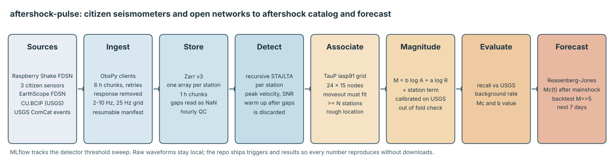
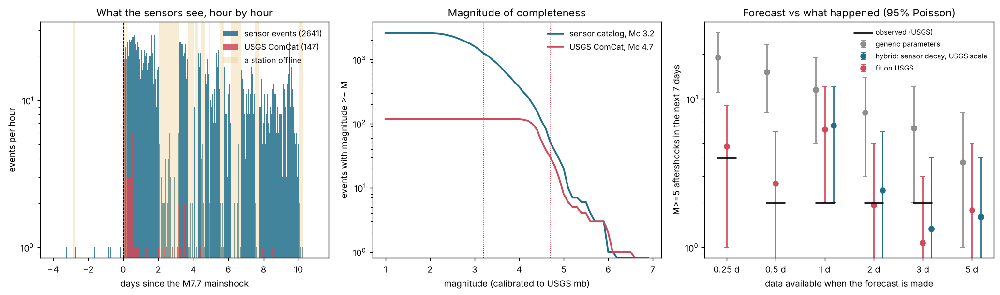

# aftershock-pulse

Aftershock detection and forecasting from citizen seismometers and open networks, measured on the
M7.7 Panama earthquake of 9 October 2026.

Three Raspberry Shake sensors that people keep at home on the Azuero peninsula, plus one USGS
station on Barro Colorado Island, are turned into an aftershock catalog with 2,627 events in the ten
days after the mainshock. The global USGS catalog has 147 for the same area and time. The
pipeline then uses that catalog to forecast how many M5+ aftershocks to expect next, and every
forecast is scored against what actually happened.

Everything runs on a laptop CPU with public data and no API keys.



## The problem

On 9 October 2026 a M7.7 earthquake hit central Panama, 10 km deep near Pitaloza Arriba in Herrera
province. A cathedral collapsed in Penonome, the central provinces took the damage, and a tsunami
warning went out for the coasts of Panama, Colombia, Ecuador, Nicaragua and Guatemala. Two
aftershocks of M6.6 and M6.1 followed within three days.

After a large earthquake, people need two answers fast: how active is the sequence right now, and
how likely is another damaging shock in the coming days. Agencies answer the second question with
aftershock forecasts, and those forecasts are only as good as the catalog behind them. In regions
with sparse professional stations, the global catalog only sees events above about M4.5, and in the
first hours it misses most of them because the waveforms overlap.

Meanwhile there are low cost citizen sensors sitting right on top of the rupture, streaming open
data. This project asks a concrete question: what do they add, and where do they fall short?

## Why now

* **The sequence is a month old.** USGS event
  [us6000u18k](https://earthquake.usgs.gov/earthquakes/eventpage/us6000u18k) (M7.7, 9 October
  2026). Reporting the same day: [OPB / Associated Press](https://www.opb.org/article/2026/10/09/a-magnitude-7-7-earthquake-shakes-panama-prompting-evacuations/)
  and [The Washington Post](https://www.washingtonpost.com/world/2026/10/09/panama-earthquake/3aba79d0-c40e-11f1-8170-681419af1cc9_story.html).
  The USGS catalog for the area holds 147 aftershocks in the first ten days, all of them M4.1 or
  larger.
* **Citizen sensors were in place.** One Raspberry Shake (AM.RE9F3) had been running since January
  2026 about 10 km from the epicenter. Its data, and that of two more in the region, is open
  through the Raspberry Shake FDSN service.
* **The tools moved.** Zarr 3 is the current storage format for chunked arrays, and MLflow 3 put
  its file store in maintenance mode, so tracking here goes to a local SQLite database from the
  start (see [ADR 003](docs/adr-003-mlflow-sqlite-and-threshold-sweep.md)).

## Data

| Source | What | License | Downloaded |
|---|---|---|---|
| [Raspberry Shake FDSN](https://data.raspberryshake.org) | Vertical channel (EHZ, 100 Hz) of AM.RE9F3, AM.R038E and AM.SA041, 6 to 20 October 2026 | Raspberry Shake terms, cite [10.7914/SN/AM](https://doi.org/10.7914/SN/AM); raw data may not be redistributed | 2026-11-09 |
| [EarthScope FDSN](https://service.earthscope.org) | CU.BCIP BHZ (40 Hz), USGS Caribbean Network, same window | US public domain, cite [10.7914/SN/CU](https://doi.org/10.7914/SN/CU) | 2026-11-09 |
| [USGS ComCat](https://earthquake.usgs.gov/fdsnws/event/1/) | Events within 150 km of the mainshock, same window (148 rows including the mainshock) | US public domain | 2026-11-09 |

What is in the repo and why:

* `data/reference/usgs_comcat.csv`: the reference catalog (public domain).
* `data/derived/`: the 33,225 STA/LTA triggers with their amplitudes, hourly station quality and
  station coordinates. These are derived products. Raspberry Shake does not allow its raw data to
  be redistributed, so raw waveforms are never committed. `python -m aftershock_pulse ingest`
  downloads them again (about 400 MB of Zarr after processing, roughly 25 minutes).
* `data/sample/`: two hours of raw CU.BCIP (public domain) with its station metadata, used by the
  tests to exercise the real detector end to end.

Citizen stations sit at people's homes. Coordinates are rounded to 0.01 degrees everywhere in
this project. There is no personal data.

## How it works

1. **Ingest.** ObsPy FDSN clients pull each station in 6 hour chunks with 60 s of padding. Public
   services answer 502 under load (Raspberry Shake did, often), so every request retries with
   exponential backoff and a per station manifest records what is done. A rerun only fetches the
   missing chunks. Each contiguous piece of data is cleaned on its own: response sensitivity
   removed, detrend, taper, 2 to 10 Hz bandpass, Lanczos resample onto a shared 25 Hz time grid.
2. **Store.** One Zarr v3 float32 array per station covers the whole window, chunked by hour.
   Gaps are never interpolated, they read as NaN. Hourly quality (coverage, noise RMS, flat
   channels) comes straight from the store.
3. **Detect.** Recursive STA/LTA (1 s / 20 s) per station. The characteristic function restarts
   after every gap and the first 20 s are thrown away, otherwise every reconnect would look like an
   earthquake. Each trigger carries the peak velocity after the onset and its SNR.
4. **Associate.** A grid of 360 candidate sources over the aftershock zone, with P travel times
   from TauP (iasp91). A trigger at one station implies an origin time for every node; the node
   that lines up the most other stations within 2 s wins. An event needs 3 of the 4 stations.
   This rejects noise at a single house and events from elsewhere whose moveout fits no node.
5. **Magnitude.** M = log10(A) + alpha log10(R) + station term, calibrated against the USGS
   events that the detector matched (M below 6, larger ones clip the citizen sensors). Checked out
   of fold.
6. **Evaluate.** Recall against USGS by magnitude bin, detections per day in the 3.7 quiet days
   before the mainshock, completeness magnitude (maximum curvature) and b value (Aki Utsu).
7. **Forecast.** Reasenberg and Jones, fitted by maximum likelihood with the short term
   incompleteness after a large mainshock built in (Helmstetter et al. 2006). At 0.25, 0.5, 1, 2,
   3 and 5 days after the mainshock, three models forecast the number of M5+ aftershocks in the
   next 7 days: generic California parameters, a fit on USGS alone, and a hybrid that takes the
   decay from the sensor catalog and the productivity from USGS. Each one is scored on the USGS
   count that followed.

Design decisions:
[ADR 001 Zarr for continuous waveforms](docs/adr-001-zarr-for-continuous-waveforms.md),
[ADR 002 grid association and a hybrid forecast](docs/adr-002-grid-association-and-hybrid-forecast.md),
[ADR 003 MLflow on SQLite and the threshold sweep](docs/adr-003-mlflow-sqlite-and-threshold-sweep.md).

## Results

All numbers come from `python -m aftershock_pulse run` on 9 November 2026 (Python 3.13, 2 vCPU,
ObsPy 1.5.1, Zarr 3.4.2, MLflow 3.18). Detection over 14 days of four stations takes a few
seconds, association about 8 s. Raw numbers are in [reports/metrics.json](reports/metrics.json).



**Detection**

| | Sensors | USGS ComCat |
|---|---|---|
| Events in the 10 days after the mainshock | 2,627 | 147 |
| Completeness magnitude (maximum curvature + 0.2) | 3.2 (sensor scale) | 4.7 |
| Events at or above Mc | 1,262 | 39 |

The detector recovers 81% of the USGS aftershocks (119 of 147): 88% of M4.0 to 4.5, 81% of M4.5 to
5.0, 65% of M5.0 to 5.5 and 5 of 6 above M5.5. The misses are mostly in the first hours, when
events overlap and a single trigger per station cannot separate them. In the 3.7 days before the
mainshock the network fires 3.8 events per day; some of these may be real small earthquakes,
so 3.8 per day is an upper bound on false alarms.

**Threshold sweep** (MLflow, [reports/sweep.csv](reports/sweep.csv))

| STA/LTA on | Stations required | Events | USGS recall | Detections per day before the mainshock |
|---|---|---|---|---|
| 4.0 | 2 | 13,106 | 0.939 | 380.8 |
| 4.0 | 3 | 3,788 | 0.823 | 17.5 |
| 5.0 | 2 | 8,927 | 0.912 | 157.1 |
| **5.0** | **3** | **2,641** | **0.810** | **3.8** |
| 5.0 | 4 | 249 | 0.435 | 0.0 |

Two stations is not enough: with four noisy sensors some pair always lines up by chance. Going
from 4.0 to 5.0 with three stations costs 1.3 points of recall and cuts the background by 4.6x.

**Magnitude**

Out of fold over 116 matched events, the sensor magnitude correlates with USGS mb at r = 0.57,
with a mean absolute error of 0.23. That is no better than always answering the median (0.21),
because the USGS magnitudes here sit in a narrow band (mostly 4.3 to 5.0) and are rounded to 0.1.
For M5+ the error is 0.19. The b value on the sensor scale is 0.66 against 1.24 ± 0.24 for USGS:
the two scales are not the same, and the forecast is designed around that (below).

**Forecast backtest** (M5+ in the next 7 days, [reports/forecast_backtest.csv](reports/forecast_backtest.csv))

| Forecast made at | Generic | Fit on USGS | Hybrid | Observed |
|---|---|---|---|---|
| 0.25 days | 19.0 (11 to 28) | 4.8 (1 to 9) | not enough sensor data | 4 |
| 0.5 days | 15.2 (8 to 23) | 2.7 (0 to 6) | not enough sensor data | 2 |
| 1 day | 11.5 (5 to 19) | 6.2 (2 to 12) | 6.6 (2 to 12) | 2 |
| 2 days | 8.1 (3 to 14) | 1.9 (0 to 5) | 2.4 (0 to 6) | 2 |
| 3 days | 6.4 (2 to 12) | 1.1 (0 to 3) | 1.3 (0 to 4) | 2 |
| 5 days (to day 10.25) | 3.7 (1 to 8) | 1.8 (0 to 5) | 1.6 (0 to 4) | 0 |

* Generic parameters over-forecast this sequence by 2 to 5 times and the outcome falls inside
  their 95% interval only once in six. Mean Poisson log score: -6.63.
* Fitting to the sequence fixes that. Both the USGS fit and the hybrid contain the outcome every
  time. On the four dates where both exist, the mean log score is -1.98 for the hybrid and -1.99
  for USGS alone: a tie.
* So on this sequence the denser catalog did not make the M5 forecast better. What it did give is
  a decay estimate built on 124 to 322 events instead of 30 to 39.

## Run it

```bash
pip install -e ".[dev]"

# everything below the triggers, from the committed data, in about 15 s
python -m aftershock_pulse analyze

# full rebuild from the FDSN services
python -m aftershock_pulse catalog   # USGS reference catalog
python -m aftershock_pulse ingest    # waveforms into data/work/waveforms.zarr
python -m aftershock_pulse run       # quality, triggers, then analyze
python -m aftershock_pulse sweep --trigger-on 3.5 4 5 --min-stations 2 3 4

pytest
mlflow ui --backend-store-uri sqlite:///mlflow.db   # optional, to browse the runs
```

Everything is configured in [configs/panama_2026.toml](configs/panama_2026.toml): stations, window,
grid, detector and association settings. Another sequence is another config file.

## Repository

```
src/aftershock_pulse/   ingest, store, quality, detect, associate, magnitude, evaluate,
                        forecast, pipeline, report, tracking, cli
tests/                  unit tests plus an end to end test on real BCIP data and one that
                        reproduces reports/metrics.json from the committed triggers
configs/                study definition
data/                   reference catalog, derived triggers, public domain sample
reports/                metrics, events, forecast backtest, threshold sweep
docs/                   ADRs and figures
scripts/                architecture diagram
```

## Limitations

* Four stations, one of them offline for 63 of 336 hours (the shaded hours in the figure). When it
  is down, the three remaining stations all have to trigger, and small events disappear. The
  sensor event rate is not corrected for network availability yet.
* The detector saturates in the first hours, at several hundred events a day, because each station gives one
  trigger per window and overlapping events merge. The sensor catalog is only used for the decay
  after half a day for that reason.
* Locations are grid nodes 0.1 degrees apart from P times only. Good enough to say an event is in
  the zone, not to map faults.
* The sensor magnitude is a relative scale. It does not beat a constant on the narrow mb band of
  the reference events.
* Forecast intervals are Poisson only and ignore parameter uncertainty. The completeness magnitude
  is taken from the whole window, which leaks a little information into the early forecasts.

## What I would do at scale

A machine learning picker (PhaseNet or EQTransformer through SeisBench) instead of STA/LTA to
separate overlapping events in the first hours, a proper locator with S picks, a detection rate
corrected for station availability, ETAS instead of Reasenberg and Jones, and the same pipeline
running on the Raspberry Shake stream in near real time for every M6.5+ in Latin America, with the
Colombian Geological Survey network added where it is open.

## License

MIT, see [LICENSE](LICENSE). Data keeps the license of its source (table above).
